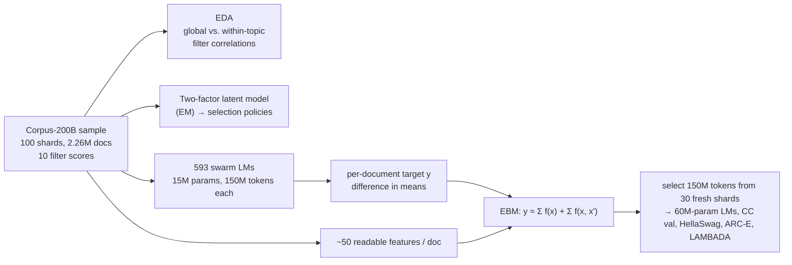

# What Makes Web Text Useful for Pretraining? Interpretable Document Quality from Filters, Latent Factors, and Model Swarms

Angikar Ghosal, Kaitlyn Wang<br>
Stanford University<br>
STATS 305C

We study which readable properties of a web document make it useful pretraining data, using
2.26M documents from [WebOrganizer/Corpus-200B](https://huggingface.co/datasets/WebOrganizer/Corpus-200B).

The work has two stages:
1. We take ten existing quality filters as the target and fit a two-factor latent model by EM.
   It recovers a benchmark axis and a generative-quality axis.
2. We train a swarm of 593 small LMs on random document subsets and estimate each document's
   contribution to validation loss by difference in means. An interpretable EBM then predicts
   that target from readable features, and we test it as a data-selection rule on held-out
   shards.



## Results

Predicting the swarm target on about 412K held-out documents:

| model | test R² |
|---|---:|
| topic only | 0.076 |
| Lasso | 0.408 |
| EBM, human-readable features | 0.656 |
| EBM, all features | 0.668 |

- **Stage 1:** a top-20% selection by the two-factor posterior reaches quality 0.680, against
  0.405 for global DCLM.
- **Held-out selection:** 60M LMs train on 150M-token selections from 30 fresh shards.
  Applying the EBM within topics gives the lowest CommonCrawl validation loss (3.873, vs.
  3.884 for random). DCLM is best on ARC-Easy and LAMBADA.

Full tables are in the paper.

## Quickstart

The quickstart runs on CPU in about a minute, using a bundled sample of 10K held-out
documents with their swarm targets.

```bash
git clone https://github.com/kkaitlyn111/pretrain-quality.git
cd pretrain-quality
make quickstart
```

```text
[extract] check vs. full-pipeline values: 100.00% of doc x feature cells match
[fit] bundled full-data EBM-no-PC (trained on 1.65M docs), R^2 on these held-out docs: 0.662
      Lasso       R^2 = 0.418
      EBM-no-PC   R^2 = 0.645
```

The full cluster pipeline is described in [pipeline/README.md](pipeline/README.md).

## Repository layout

```text
├── report/paper.pdf        the paper
├── src/pretrain_quality/   feature code and the `pq extract` / `pq fit` quickstart
├── pipeline/               full pipeline: features, EDA, factor model, swarm, EBM, validation
├── data/sample/            10K-document sample with targets
├── models/                 full-data EBM
├── results/  figures/      result tables and paper figures
└── tests/
```

## Acknowledgements

This work builds on WebOrganizer and Corpus-200B (Wettig et al., ICML 2025). Feature scores
come from QuRater (Wettig et al., ICML 2024), perplexity-correlation filters (Thrush et al.,
ICLR 2025), a textbook-quality fastText classifier, the OpenAI RoBERTa detector, and spaCy
(see [NOTICE.md](NOTICE.md)). Models are fit with
[InterpretML](https://github.com/interpretml/interpret), and the influence experiments use
[kronfluence](https://github.com/pomonam/kronfluence). We thank Scott Linderman and the
STATS305C class for guidance and feedback on this project.

## Citation

The paper is in [report/paper.pdf](report/paper.pdf).

```bibtex
@misc{ghosal2026webtext,
  title  = {What Makes Web Text Useful for Pretraining? Interpretable Document Quality from
            Filters, Latent Factors, and Model Swarms},
  author = {Ghosal, Angikar and Wang, Kaitlyn},
  year   = {2026},
  note   = {Stanford STATS 305C}
}
```

## License

The code is released under the MIT license ([LICENSE](LICENSE)). The bundled sample text and
third-party model outputs keep their original terms ([NOTICE.md](NOTICE.md)).
