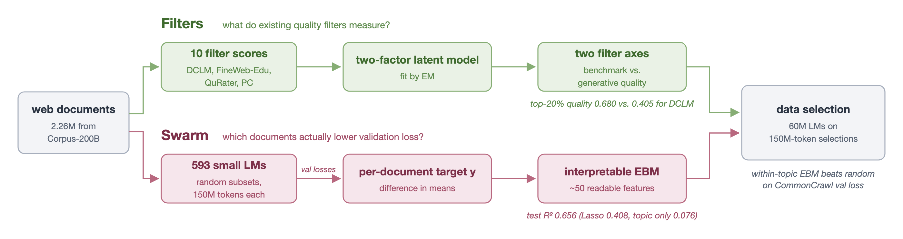
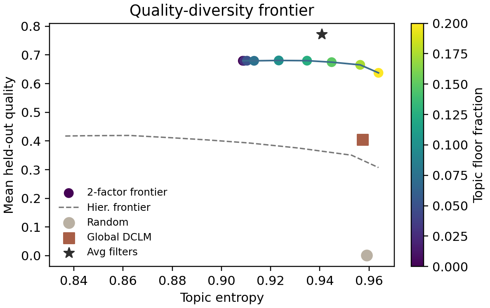
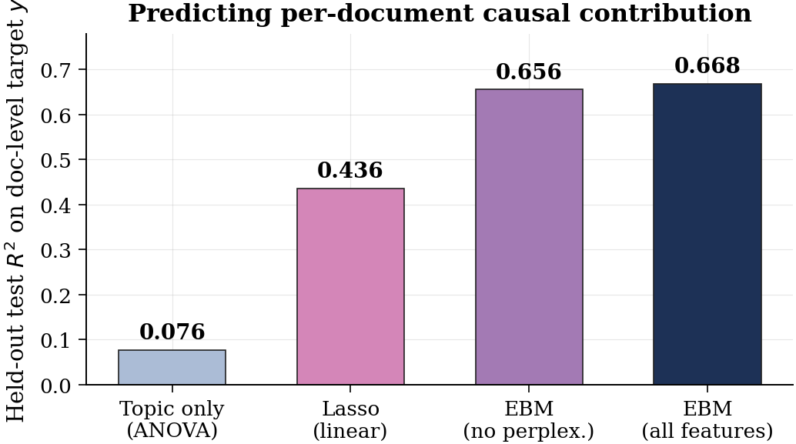

# What Makes Web Text Useful for Pretraining? Interpretable Document Quality from Filters, Latent Factors, and Model Swarms

Angikar Ghosal, Kaitlyn Wang<br>
Stanford University<br>
STATS 305C

We ask which interpretable properties of a web document predict its usefulness as
language-model pretraining data. The study uses 2.26M documents from
[WebOrganizer/Corpus-200B](https://huggingface.co/datasets/WebOrganizer/Corpus-200B), each
annotated with ten quality filters, and proceeds in four steps:

1. Filter disagreement: Global and within-topic Spearman correlations between the filters
   differ by less than 0.07 everywhere. Filters therefore disagree at the document level
   inside topics, not because they rank topics differently.
2. Latent factors: A two-factor Gaussian measurement model fit by EM recovers two
   interpretable filter axes. One is a *benchmark* axis (ARC-Easy, PIQA, SciQ); the other is a
   *generative-quality* axis (DCLM, FineWeb-Edu, LAMBADA). The model's posterior score
   defines a tunable quality–diversity selection policy.
3. An independent target: To replace the circular filter-against-filter target, we train
   593 small language models on randomized document subsets. We then estimate each
   document's contribution *y* to held-out validation loss by difference in means.
4. Interpretable prediction and validation: An Explainable Boosting Machine on
   human-readable features reaches test R² = 0.656, against a split-half noise ceiling of
   0.57–0.70. When we use it to select data for 60M-parameter LMs, the full EBM applied within
   topics is the only learned filter that beats random selection on broad CommonCrawl
   validation loss.



## Results

### Two latent filter axes (paper Table 1)

These are top-20% selection policies on held-out documents. Quality is the mean of the six
standardized filter scores.

| policy | quality | topic entropy |
|---|---:|---:|
| random | 0.001 | 0.999 |
| global DCLM | 0.405 | 0.957 |
| one-factor posterior | 0.448 | 0.952 |
| two-factor posterior | **0.680** | 0.851 |
| two-factor, 20% within-topic floor | 0.638 | 0.964 |

Factor 1 loads on ARC-Easy (0.87), PIQA (0.80) and SciQ (0.47). Factor 2 loads on DCLM (0.27),
FineWeb-Edu (0.27) and LAMBADA (0.23). The two-factor policy with a 20% within-topic floor
improves on global DCLM by 0.274 standardized units (95% CI 0.261–0.291).

<p align="center">
  
  
</p>

### Predicting the swarm target (paper Table 2)

The test set is about 412,000 held-out documents (an 80/20 split stratified by topic).

| model | train R² | test R² | features |
|---|---:|---:|---|
| topic only (ANOVA) | | 0.076 | topic |
| Lasso | 0.410 | 0.408 | full panel |
| EBM, no perplexity-correlation scores | 0.658 | **0.656** | human-readable |
| EBM, full | 0.671 | 0.668 | full panel |

The split-half reliability of *y* is 0.40, which implies an R² ceiling of 0.57–0.70. The
human-readable EBM gets 99% of the full EBM's test R². "Human-readable" means every feature
except the four perplexity-correlation scores. In code
(`pretrain_quality.features.columns.NO_PC_FEATURES`) that is 44 continuous columns plus the
categorical topic and format:
- the 16 Gopher heuristics;
- 18 discourse, structure and readability features;
- 3 spaCy entity features;
- 4 QuRater axes;
- textbook quality;
- the AI-text detector;
- token count.

<p align="center">
  
  
</p>

The strongest signals in the EBM are:
- QuRater educational value: monotone increasing.
- Textbook-quality score: peaks near 0.5, then saturates.
- Proper-noun density: penalized at high values.
- Mean word length: increasing.
- Fraction alphabetic: increasing.
- First-person sentence fraction: decreasing.

First-person fraction and proper-noun density both have steep negative regions at their high
ends, which flag diary-style content and entity dumps.


### Downstream validation (paper Table 3)

Each policy selects 150M unique tokens from 30 fresh shards (612K documents). We then train a
60M Llama for 2 epochs. CC is held-out CommonCrawl validation loss.

| policy | CC ↓ | HellaSwag ↑ | ARC-Easy ↑ | LAMBADA ↓ |
|---|---:|---:|---:|---:|
| random (seed 42) | 3.884 | .313 | .349 | 4.528 |
| random (seed 43) | 3.887 | .315 | .332 | 4.564 |
| random (seed 44) | 3.896 | .311 | .340 | 4.501 |
| EBM full, within topic | **3.873** | **.320** | .316 | 4.724 |
| EBM full | 3.914 | .308 | .337 | 5.168 |
| EBM full (seed 43) | 3.918 | .311 | .326 | 5.212 |
| EBM no-PC | 3.921 | .307 | .326 | 5.169 |
| Lasso | 3.960 | .303 | .370 | 5.307 |
| DCLM-fastText | 4.006 | .304 | **.379** | **4.350** |
| FineWeb-Edu | 3.967 | .308 | .365 | 4.746 |

Applied within topics, the full EBM is best on CC validation and HellaSwag. Every global
top-k filter loses to random on broad CommonCrawl loss, by 0.02–0.13 nats. DCLM-fastText,
which was trained against benchmark-like positives, wins ARC-Easy and LAMBADA. The best
selection rule depends on the target metric and on the diversity constraint.

## Quickstart (CPU, about 1 minute)

The repository bundles a 10,000-document sample (`data/sample/`, 14 MB) drawn from the EBM's
held-out test split. Each document comes with its swarm target *y*.
- `pq extract` recomputes the 34 CPU text features from raw text and checks them against the
  full pipeline's values. The model-scored features (QuRater, textbook quality, AI detector,
  spaCy entities) ship precomputed; `--recompute` reruns them.
- `pq fit` fits Lasso and the human-readable EBM on an 80/20 split of the sample. It also
  scores the bundled full-data EBM on the same documents.

```bash
git clone https://github.com/kkaitlyn111/pretrain-quality.git
cd pretrain-quality
make quickstart          # creates .venv, installs the package, runs `pq extract` and `pq fit`
```

This is the output from a fresh environment on a 16-core CPU node. "44 continuous + 2
categorical" is the human-readable feature set described above.

```text
[extract] 10,000 docs from data/sample/docs.parquet
[extract] 34 CPU features in 12.8s (16 workers)
[extract] model features: rest precomputed by the full pipeline
[extract] check vs. full-pipeline values: 100.00% of doc x feature cells match
[fit] 10,000 docs, 44 continuous + 2 categorical features (EBM-no-PC feature set)
[fit] bundled full-data EBM-no-PC (trained on 1.65M docs), R^2 on these held-out docs: 0.662
[fit] trained on 8,000, tested on 2,000 (stratified by topic)
      topic-only  R^2 = 0.111
      Lasso       R^2 = 0.418   (5s)
      EBM-no-PC   R^2 = 0.645   (train 0.672, 31s)
[fit] top 10 EBM terms by mean |contribution|:
       1. qr_educational_value                       0.00420
       2. textbook_quality                           0.00342
       3. frac_alpha                                 0.00291
       4. mean_word_length                           0.00284
       5. first_person_fraction                      0.00265
       6. flesch_reading_ease                        0.00247
       7. qr_required_expertise                      0.00247
       8. flesch_kincaid_grade                       0.00222
       9. qr_facts_and_trivia                        0.00203
      10. proper_noun_density                        0.00184
```

An EBM trained on only 8,000 documents comes within 0.02 of the full-data model on the same
held-out documents, and it ranks the same leading features. To recompute the model-scored
features too:

```bash
pip install -e ".[models]"
pq extract --recompute entities,textbook      # CPU; textbook downloads a large fastText model
pq extract --recompute ai,qurater             # GPU recommended (QuRater has 1.3B parameters)
pq fit
```

The first run downloads NLTK's CMUdict, which textstat uses for syllable counts, into
`~/.cache/pretrain-quality/nltk_data`. Set `PQ_NLTK_DATA` to put it somewhere else.

## Full pipeline

The full run reproduces every stage of the paper on a SLURM GPU cluster. All paths and
cluster settings come from `config/cluster.env` (copy `config/cluster.env.example`), and the
repository stores no credentials. Stage-by-stage commands are in
[`pipeline/README.md`](pipeline/README.md).

| paper section | code |
|---|---|
| 2 Data, per-document features | `pipeline/features/`, `pipeline/scripts/00`–`03` |
| 2.2 Exploratory findings | `pipeline/eda/filter_correlations.py` |
| 3.1, 4.1, 5.1 Two-factor model, policies, frontier | `pipeline/factor_model/` |
| 3.2, 4.2 Swarm target | `pipeline/scripts/04`–`06`, `run_diagnostic.py`, `train_lm.py` |
| 3.3, 5.2 EBM | `pipeline/scripts/07`–`08` |
| 5.3 Downstream validation | `pipeline/scripts/09`–`12` |
| 6 Influence functions (negative result) | `pipeline/influence/` |

## Repository layout

```text
├── report/paper.pdf               the paper
├── src/pretrain_quality/          installable package: feature code shared by quickstart and pipeline
│   ├── features/                  heuristics.py, synth.py, models.py (spaCy, fastText, HF scorers)
│   ├── quickstart.py              `pq extract` / `pq fit`
│   └── paths.py                   all locations, from PQ_* environment variables
├── pipeline/                      full cluster pipeline (see pipeline/README.md)
│   ├── features/  eda/  factor_model/  scripts/  influence/  slurm/
├── data/sample/                   10K-document quickstart sample with targets
├── models/ebm_no_pc.joblib        full-data human-readable EBM (interpret 0.7.8)
├── results/                       summary statistics and result tables
├── figures/                       paper figures
├── scripts/build_sample.py        how data/sample was built
├── config/cluster.env.example
└── tests/                         unit tests for the text features
```

## Acknowledgements

This work builds on WebOrganizer and Corpus-200B (Wettig et al., ICML 2025). Feature scores
come from QuRater (Wettig et al., ICML 2024), perplexity-correlation filters (Thrush et al.,
ICLR 2025), a textbook-quality fastText classifier, the OpenAI RoBERTa detector, and spaCy
(see [NOTICE.md](NOTICE.md)). Models are fit with
[InterpretML](https://github.com/interpretml/interpret), and the influence experiments use
[kronfluence](https://github.com/pomonam/kronfluence). We thank Scott Linderman and the
STATS305C class for guidance and feedback on this project.

## Citation

The paper is in [report/paper.pdf](report/paper.pdf).

```bibtex
@misc{ghosal2026webtext,
  title  = {What Makes Web Text Useful for Pretraining? Interpretable Document Quality from
            Filters, Latent Factors, and Model Swarms},
  author = {Ghosal, Angikar and Wang, Kaitlyn},
  year   = {2026},
  note   = {Stanford STATS 305C}
}
```

## License

The code is released under the MIT license ([`LICENSE`](LICENSE)). The bundled sample text and
third-party model outputs keep their original terms ([`NOTICE.md`](NOTICE.md)).
