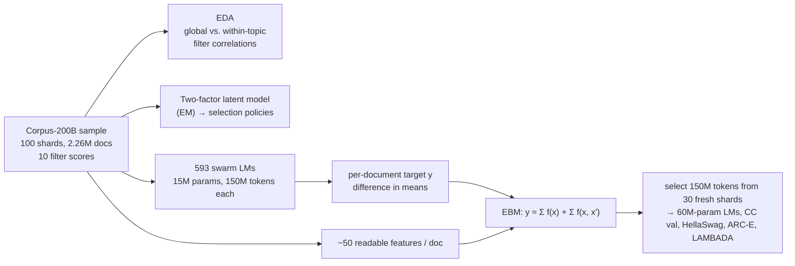

# What Makes Web Text Useful for Pretraining? Interpretable Document Quality from Filters, Latent Factors, and Model Swarms

Angikar Ghosal, Kaitlyn Wang<br>

Pretraining data filters vary in methods and often disagree on which web documents are "high quality", and what is empirically successful is often hard to interpret. Using web documents from
[WebOrganizer/Corpus-200B](https://huggingface.co/datasets/WebOrganizer/Corpus-200B), we first
model ten existing empirically successful filters with a two-factor latent model fit by EM. In the second stage, we estimate ground truth targets through model swarms (we estimate each document's effect on validation loss by training 593 small LMs
on random document subsets), and predict that effect from readable features with an Explainable Boosting Machine (EBM). The EBM reaches
a test R² of 0.656, and applied within topics it selects data with lower validation loss than
random selection. We investigate a host of features that are hypothesized to matter across literature and find some interesting interpretable results!



## Results

| Predicting y (held-out documents) | Test R² ↑ |
|---|---:|
| Topic only | 0.076 |
| Lasso | 0.408 |
| EBM, no perplexity-correlation features | 0.656 |
| EBM, all features | **0.668** |

| Selection policy (60M LMs, 150M tokens) | CC val loss ↓ | ARC-Easy ↑ |
|---|---:|---:|
| EBM within topics | **3.873** | 0.316 |
| Random | 3.884 | 0.349 |
| FineWeb-Edu | 3.967 | 0.365 |
| DCLM | 4.006 | **0.379** |

The two-factor model's top-20% selection reaches a held-out quality of 0.680, against 0.405
for DCLM.


## Quickstart

```bash
git clone https://github.com/kkaitlyn111/pretrain-quality.git && cd pretrain-quality
make quickstart   # feature extraction and EBM fit on a bundled 10K-document sample (CPU, ~1 min)
```

The full pipeline is described in [pipeline/README.md](pipeline/README.md).

## Acknowledgements

This work builds on WebOrganizer and Corpus-200B (Wettig et al., ICML 2025). Feature scores
come from QuRater (Wettig et al., ICML 2024), perplexity-correlation filters (Thrush et al.,
ICLR 2025), a textbook-quality fastText classifier, the OpenAI RoBERTa detector, and spaCy
(see [NOTICE.md](NOTICE.md)). Models are fit with
[InterpretML](https://github.com/interpretml/interpret), and the influence experiments use
[kronfluence](https://github.com/pomonam/kronfluence). We thank Scott Linderman and the
STATS305C class for guidance and feedback on this project!

## Citation

The paper is in [report/paper.pdf](report/paper.pdf).

```bibtex
@misc{ghosal2026webtext,
  title  = {What Makes Web Text Useful for Pretraining? Interpretable Document Quality from
            Filters, Latent Factors, and Model Swarms},
  author = {Ghosal, Angikar and Wang, Kaitlyn},
  year   = {2026},
  note   = {Stanford STATS 305C}
}
```

The code is released under the MIT license ([LICENSE](LICENSE)).
